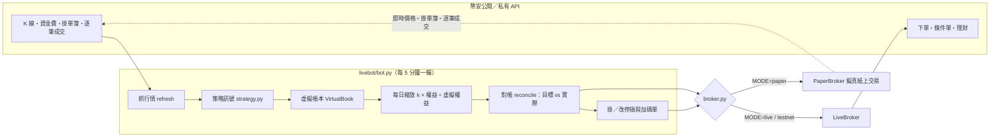

# qbot：幣安 USDⓈ-M 合約交易機器人框架

一個從研究、回測驗證到雲端 24 小時運作的加密貨幣量化交易系統。這個 repo 是**公開的作品集版**：完整的機器人框架、擬真紙上交易引擎與部署工具都在這裡，**實際使用的交易策略不公開**，`livebot/strategy.py` 換成了一個均線示範策略。

> ⚠️ 示範策略只用來展示框架怎麼接策略，沒有經過最佳化，請不要直接拿來交易。任何交易都有虧損風險。

## 特色

- **虛擬帳本 × 縮放倍數**：策略在一個「全倍數」虛擬帳戶上跑，實際部位 = 縮放倍數 × 虛擬部位，每天依帳戶權益與波動重新計算。這樣實盤和回測用的是**同一份邏輯**，可以逐筆比對。
- **擬真紙上交易**（不需要 API 金鑰，全部用幣安即時公開資料）：
  - 市價單依下單當下的**掛單簿逐檔吃單**算成交均價
  - 停損每幾秒用最新成交價檢查；觸發後用**逐筆成交**找出第一筆穿越停損價的價格，再加上掛單簿衝擊
  - 兩次檢查之間的插針，用 1 分鐘／5 分鐘 K 補抓，並排除掛單之前的價格
  - 每個持倉幣都套用幣安**實際結算的資金費率與標記價格**
  - 吃單手續費、保證金不足拒單，都比照交易所
  - 每筆成交寫進 `fills.csv`（參考價、成交價、滑價 bps、手續費），方便和回測假設比較
- **實盤安全設計**：
  - 停損單和加碼單預先掛在交易所，主機斷線時停損照樣有效
  - 下單網路中斷時先用 clientOrderId 查詢，避免重複下單
  - 帳戶狀態原子寫入；重啟後自動補算錯過的 K 線
  - 同一份狀態只允許一個機器人在跑（檔案鎖）
  - 目標曝險超過上限就停手；`HALT` 檔案可隨時暫停開新倉；`flatten` 一鍵全部平倉
  - 啟動前檢查 API 金鑰權限，**開了提現權限就拒絕啟動**
- **閒置資金放貸**：沒有持倉時，把閒置 USDT 轉進幣安活期理財，要進場前自動贖回。
- **小資金友善**：依幣安的最小下單量與最小名目自動略過太小的單。
- **只用 Python 標準函式庫連幣安**，相依套件只有 numpy、pandas、scipy。

## 架構



| 檔案 | 用途 |
|---|---|
| `livebot/bot.py` | 主程式：排程、行情、虛擬帳本推進、對帳、停損管理、放貸、狀態 |
| `livebot/broker.py` | `PaperBroker`（擬真紙上交易）與 `LiveBroker`（實盤），介面相同 |
| `livebot/binance.py` | 幣安 REST 介面（簽章、重試、時間校正、條件單新端點 algoOrder） |
| `livebot/strategy.py` | 策略介面與**示範策略**（換成自己的策略只要維持相同函式） |
| `deploy/` | systemd 服務檔、Windows 一鍵查看狀態腳本 |
| `docs/` | 雲端部署教學、紙上交易擬真方法、回測驗證方法 |
| `tests/` | 離線測試（不連網路） |

## 研究與驗證方法

實際策略是經過多輪研究挑出來的。每一輪都遵守同樣的流程，避免「回測很漂亮、實盤很難看」：

1. **事前固定規格**：先寫好要測的設定和通過條件，看到結果後不再調參數。
2. **7:3 樣本外切分**：前 70% 挑設定，後 30% 只用來驗證，不參與挑選。
3. **參數鄰域檢查**：好的設定周圍也要好，不能是孤峰。
4. **區塊自助法（Block Bootstrap）**：估計 Sharpe 的信賴區間，保留報酬的自相關。
5. **Deflated Sharpe Ratio**：把「試了很多組總會碰到好結果」的運氣扣掉。
6. **回測與實盤逐項重播**：用歷史資料逐根餵給實盤程式，訊號、成交、淨值都要和回測一致（實測淨值最大相對誤差約 10⁻¹⁵）。
7. **擬真紙上交易**：上實盤前先用真實掛單簿和逐筆成交跑幾週。

## 回測摘要（實際策略，非示範策略）

2022-02 ～ 2026-10，新台幣計價，含手續費、滑價與資金費。後 30% 為樣本外測試段。

| | 實際策略 | 單純持有 BTC |
|---|---|---|
| 樣本外測試段 總報酬 | +152% | −20% |
| 樣本外測試段 最大回撤 | −24% | −51% |
| 樣本外測試段 Sharpe | 1.40 | −0.19 |
| 全期 最大回撤 | −44% | −64% |

> 回測不代表未來績效。依 Deflated Sharpe 檢查，這樣的優勢在統計上還不能完全排除運氣，因此目前以擬真紙上交易持續驗證中。

## 快速開始（紙上交易，不需要金鑰）

```bash
git clone <this repo> && cd qbot
python -m venv .venv && . .venv/bin/activate      # Windows: .venv\Scripts\activate
pip install -r livebot/requirements.txt
cp livebot/.env.example livebot/.env              # 預設 MODE=paper
python -m livebot.bot once                        # 跑一輪
python -m livebot.bot run                         # 每 5 分鐘一輪，持續運作
python -m livebot.bot status                      # 看損益、手續費、滑價、資金費
```

測試：`pip install pytest && python -m pytest tests`

雲端 24 小時部署（Oracle Cloud 免費主機、systemd、自動開機排程）見 [docs/deploy.md](docs/deploy.md)。

## 安全須知

- **API 金鑰只放在你自己主機的 `livebot/.env`**，權限設成 `chmod 600`，並已列在 `.gitignore`。不要上傳、不要貼給任何人。
- 金鑰只開需要的權限，**不要開提現**，並綁定主機的固定 IP。
- 停損、縮倉、保證金緩衝都只是降低風險，**不保證不會爆倉**；極端跳空、交易所故障、API 中斷都可能造成比回測更大的虧損。

## 授權

© 2026 jylinn. All rights reserved. 歡迎閱讀與學習程式架構；未經同意請勿將本專案用於商業用途或重新散布。
